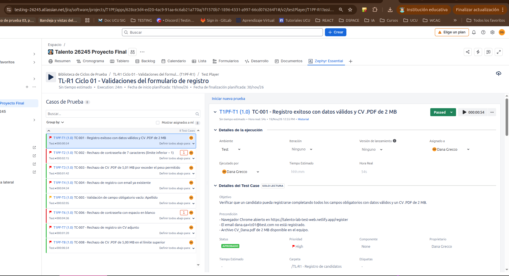

# Evidencias de ejecución – Zephyr Essential

## Proyecto Talento Lab

Esta sección documenta los resultados de las pruebas funcionales realizadas sobre el formulario de registro de Talento Lab.

**Herramienta:** Jira – Zephyr Essential  
**Ciclo:** TL-R1 – Ciclo 01 – Validaciones del formulario de registro  
**Ambiente:** Test

## Resumen de ejecución

| Indicador | Resultado |
|---|---:|
| Casos ejecutados | 8 |
| Casos aprobados | 6 |
| Casos fallidos | 2 |
| Porcentaje de aprobación | 75% |
| Porcentaje de fallos | 25% |

## Defectos identificados

- **BUG-001:** el sistema permite registrar usuarios con contraseñas de 7 caracteres.
- **BUG-002:** el sistema permite contraseñas que contienen espacios en blanco.

## Evidencia del ciclo

La captura permite visualizar los estados de las ejecuciones registradas en Zephyr Essential.

## Observaciones

Los resultados documentados corresponden al ciclo TL-R1 del proyecto Talento 26245 Proyecto Final.

Los identificadores de este ciclo son T1PF-T1 a T1PF-T8, mientras que los casos originalmente documentados en la planilla corresponden a TC-001 a TC-008.
