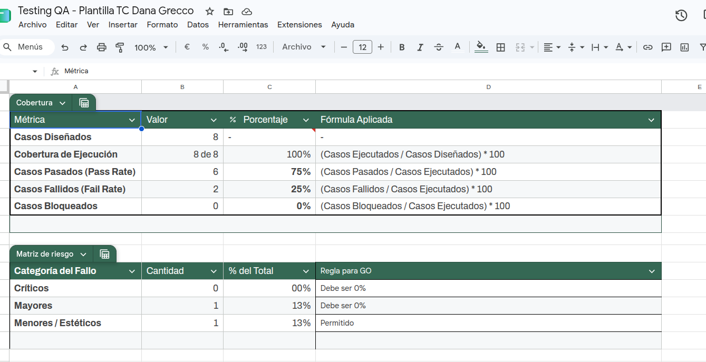

# Métricas de calidad — Talento Lab

## Contexto

Este documento resume los indicadores registrados en la pestaña **Cobertura** de la planilla de testing del formulario de registro de Talento Lab. Los resultados documentados corresponden a ocho casos de prueba y dos defectos registrados.

## Cobertura y ejecución

| Métrica | Valor | Porcentaje |
| --- | ---: | ---: |
| Casos diseñados | 8 | — |
| Cobertura de ejecución | 8 de 8 | 100% |
| Casos aprobados (Pass Rate) | 6 | 75% |
| Casos fallidos (Fail Rate) | 2 | 25% |
| Casos bloqueados | 0 | 0% |

### Fórmulas utilizadas

- **Cobertura de ejecución:** casos ejecutados / casos diseñados × 100.
- **Pass Rate:** casos aprobados / casos ejecutados × 100.
- **Fail Rate:** casos fallidos / casos ejecutados × 100.
- **Bloqueados:** casos bloqueados / casos ejecutados × 100.

## Matriz de riesgo

| Categoría de fallo | Cantidad | Porcentaje mostrado en la planilla | Regla para GO | Evaluación |
| --- | ---: | ---: | --- | --- |
| Críticos | 0 | 0% | Debe ser 0% | Cumple |
| Mayores | 1 | 13% | Debe ser 0% | No cumple |
| Menores / estéticos | 1 | 13% | Permitido | Permitido |

**Nota metodológica:** en esta plantilla, el porcentaje de cada categoría se calcula dividiendo la cantidad de defectos de esa categoría entre los ocho casos diseñados. Para una categoría con un defecto, el resultado exacto es 12,5%, mostrado como 13% por redondeo. Por lo tanto, esos porcentajes no representan la distribución de severidades sobre los dos defectos.

## Defectos relacionados

- [BUG-001 — El sistema acepta contraseñas de 7 caracteres](../02-reportes-de-bugs/BUG-001-contrasena-7-caracteres.md): severidad Alta, prioridad Alta.
- [BUG-002 — El sistema acepta contraseñas con espacios](../02-reportes-de-bugs/BUG-002-contrasena-con-espacios.md): severidad Media, prioridad Alta.

## Evaluación de salida a producción

**Recomendación de QA: NO-GO.** Aunque la cobertura de ejecución es del 100% y el 75% de los casos pasó, la matriz registra un defecto de severidad Alta y la regla para fallos mayores exige cero. Se recomienda corregirlo, volver a ejecutar los casos afectados y realizar las pruebas de regresión necesarias antes de reconsiderar la salida a producción.

La decisión final sobre el lanzamiento corresponde a los responsables del proyecto. Esta evaluación refleja los datos documentados en la planilla de cobertura.

## Evidencia

### Matriz de cobertura y riesgo

Captura de la planilla de seguimiento de pruebas funcionales de Talento Lab, elaborada en Google Sheets. Presenta los indicadores de ejecución (100%), aprobación (75%) y fallos (25%), junto con la matriz de riesgo utilizada para evaluar la salida a producción.

La presencia de un defecto de severidad Alta fundamenta la recomendación de **NO-GO**.

### Ejecuciones de prueba

Consultar las [evidencias de ejecución en Zephyr Essential](../03-evidencias-zephyr/README.md).
